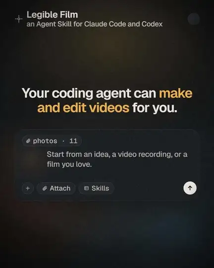

<h1 align="center"></h1>

<p align="center">
  <a href="https://github.com/JamesDimachkie/legible-film/actions/workflows/ci.yml"></a>
  <a href="https://github.com/JamesDimachkie/legible-film/releases/latest"></a>
  <a href="LICENSE"></a>
</p>

<h3 align="center">Your coding agent makes the video. Picture and sound keep one clock.</h3>

<p align="center">
  <a href="https://jamesdimachkie.com/work/legible-film"></a>
</p>

<p align="center"><em>The opening of the launch film, made by Claude Code with this skill.
<a href="https://jamesdimachkie.com/work/legible-film">Watch all of it with sound</a> (1 min 47 s).</em></p>

Legible Film is an Agent Skill for Claude Code, Codex and other coding agents. Ask for a video and the agent can draw
launch films and motion graphics, cut interviews, podcasts and tutorials from their transcripts, caption and mix them,
design sound for a finished picture, follow an editor's Premiere revisions, and check the file before it ships. The
film stays readable as text, every render is a version that never changes, and every check says what it looked at and
what it could not.

In a terminal with Node.js, from your project folder:

```
npx skills add JamesDimachkie/legible-film
```

Then ask your agent once, `/legible-film setup` in Claude Code or `$legible-film setup` in Codex, to check this
machine, and give it a job in your own words:

```
/legible-film cut a 60-second story from interview.mp4 and the b-roll in broll/
/legible-film make a 30-second launch film for the product in this folder
/legible-film cut this episode from the two mics and two cameras in raw/, with captions
/legible-film shorts three 30-second clips from podcast.mp4 for Reels, captions burned in
/legible-film score the approved picture: sparse, warm, a hit when the logo locks
/legible-film check export.mp4 before I post it
/legible-film handoff v003 to Premiere so the editor can finish it
```

Cursor, Gemini CLI, GitHub Copilot, OpenCode, Amp, Goose and other agents that read Agent Skills load it too.
[Install](#install) has the Claude Code plugin and the other ways in, and
[examples/prompts.md](examples/prompts.md) has more requests. Created by James Dimachkie.

<p align="center">
  
</p>

*One request in Claude Code, 10 min 42 s shown in 8 s: the agent mapped the clip, wrote and checked a paper edit,
rendered it, had it reviewed by an agent that did not make it, rendered a fourth version and checked the file. The
lines are excerpts, verbatim from the run. Footage: Tears of Steel (© Blender Foundation,
[CC BY 3.0](https://creativecommons.org/licenses/by/3.0/)).*

## Why

An agent can assemble a video and inspect frames and measurements, but it cannot watch the cut at normal speed or
hear it. You can watch and listen, but you cannot easily see what the agent did. Mistakes slip through between the two:
a cut lands in the middle of a word, a caption stays up after the line is gone, the music buries the voice, a revision
quietly changes a scene you had approved. Legible Film keeps the edit, the versions and the checks readable for both of
you.

- **The edit is a script you can read.** `film.md` says who the film is for and what it should leave them with, then
  lists the lines in the order they play. Strike a word to cut it. A diff lists what changed between versions.
- **The agent gets evidence.** Each source is mapped by what it contains: a word-timed transcript made on your machine,
  shots with contact sheets, loudness and silences. Cuts inside a spoken line go in a quiet stretch measured in the
  audio, and a join without one is flagged for a person to listen to.
- **Picture and sound share one clock.** The cue list is exported from whatever owns the timeline, with the picture's
  exact identity, so a retime makes the old list, bed and mix stale and every tool refuses them.
- **Checks run on the file a viewer receives,** in plain states: pass, look, fail, needs you, not assessed. Nothing is
  called watched or heard until a person has watched or heard it.

A paper edit looks like this. `>` is a spoken line, `-` a picture, `~` a cutaway over the line above:

```markdown
## Hook
> int_01 12:03.40-12:07.10 We tried everything. ~~Honestly,~~ nothing held up in the field.
- broll_04 0:12.00-0:14.10 Crew unloading the van
## Why
> int_01 14:20.00-14:24.60 So we built the tool we needed, in six weeks.
  ~ screen_02 0:41.00-0:47.00 x1.5 Dashboard loads, push in to the map
```

After each stage the agent posts one line you can read at a glance:

```
v3 checked · 11 checks pass · 1 to look at · 2 need you
```

## How it works

The agent picks one of six paths by who owns the timeline, and loads only what that path needs:

| Path | For | The timeline |
|---|---|---|
| create | launch films, motion graphics, social posts, loops, kinetic type, explainers drawn in code | a page (the film kit, HyperFrames, or Tesseract when you choose it) |
| cut | interviews, podcasts, tutorials, tightening, shorts, trailers from finished films, montages | the paper edit, `film.md` |
| insert | animation, titles and tracked graphics inside footage, timed to its words | the host edit |
| sound | effects, a score or a rescore for a picture that stays as it is | the picture |
| editor | an editor's Premiere or Resolve revisions, stale captions, a hand-off as XML | their timeline |
| quick | one file: a trim, reframe, conversion, captions, a check, a question about its sound | the file |

Every path but quick starts by stating what the film is, for whom, why, and what the viewer knows by which second,
asking only for what is missing. Every path ends the same way: Check, Screen, Revise, Deliver.

**Podcasts and multi-camera interviews.** `map.py sync` lines up cameras and mics from their sound, with no clap, and
reports its confidence and drift. A line can then take its sound from a lined-up mic (`{sound mic_01}`) and show another
camera at the same moment without retyping times (`~ cam_02 sync`). Speakers are labelled from the mics, from an
imported transcript, or by an optional local model on one shared track, and captions break where the speaker changes.
Labels are drafts until a person reads them.

<details>
<summary>Every command</summary>

Each opens one path ([commands](skills/legible-film/references/commands.md) has the full map):

| Command | Path | For |
|---|---|---|
| `kit` (also `teaser`) | create | A type-led film, a beat-cut teaser, a sting or a loop |
| `look` (also `moodboard`) | create | Your references, or your expectations when you have none, for this film |
| `taste` (also `preferences`) | create | The preferences you have confirmed, read while planning and checked where measurable |
| `studio` | create | The best film a budget allows |
| `launch`, `design`, `motion` | create | A launch film, a designed film or motion graphics |
| `map` | cut | Make the sources readable: transcripts, shots, sound |
| `plan` (also `brief`, `film`) | cut | The brief when one is needed, and the paper edit |
| `cut` | cut | Render the paper edit into a version |
| `shorts` (also `cutdown`) | cut | Short clips from a long video, or a new length or shape |
| `tighten` | cut | Shorten the dead air in a recording, as a paper edit you can read and undo |
| `screen` (also `review`) | the project's own | Open the Screening Room |
| `revise` | the project's own | Turn notes into a new version, and show what else changed |
| `deliver` | the project's own | Final files, captions, mastering and a delivery report |
| `insert` | insert | An animation in place of a passage's picture, timed to its words |
| `graphics` (also `cavalry`) | insert | A lower third, logo or title over the footage, made in Cavalry (driven by the agent) or another engine |
| `spatial` (also `track`, `blur`) | insert | Pin a graphic to a moving surface, put a title behind a person, blur a moving face |
| `score`, `mix` | sound | Sound to picture; a voice over music |
| `sound`, `sfx` | sound | Sound or effects for a picture |
| `premiere` | editor | Follow an editor's Premiere timeline and captions through revisions |
| `handoff` (also `export`) | editor | A version as a timeline Premiere or Resolve opens, with its captions |
| `quick` | quick | A simple change to one file: trim, reframe, convert, compress, GIF |
| `convert` | quick | Convert one file |
| `check` | quick, or the project's own | Check a version or any file |
| `captions` | quick, or the project's own | Captions for a video |
| `grade` | quick | A scorecard for a version or any video |
| `setup` (also `doctor`) | before any path | What this machine can do and how to fix the rest; installs local transcription or the film kit's browser with your yes |

</details>

## The Screening Room

<picture>
  <source media="(prefers-color-scheme: dark)" srcset=".github/media/screening-room-dark.png">
  
</picture>

One local page holds the cut, its script, the checks, your notes and every version. Play it and the script follows;
click a line to jump to it. Press `N` to leave a note pinned to the moment and the words being spoken, and shuttle with
J, K and L as in an editor. Your notes land in the project folder as you write them, and the page follows new versions
as the agent renders them. It runs on your machine only, behind a private link; nothing is uploaded.

To review away from your machine or with a client, [Flask](https://flask.do) is the collaboration layer this project
recommends. The agent posts each version through Flask's MCP server, brings every note back and answers it in the next
version, and nothing is uploaded without your yes.

## Try it

From a clone of this repository, a check and a first cut of a bundled 23-second scene from
[Tears of Steel](examples/first-cut/README.md). CI runs these lines as written on fresh Linux, macOS and Windows
machines.

```
git clone https://github.com/JamesDimachkie/legible-film
cd legible-film
```

<details>
<summary>The steps</summary>

<!-- first-value:start -->
First, FFmpeg 5.1 or later and Python 3.9 or later. Open the steps for your system:

<details>
<summary>Linux (tested on Ubuntu 24.04 and Debian 12)</summary>

On Linux (Ubuntu 22.04 and Debian 11 ship an FFmpeg older than 5.1, which `setup.py` reports with what to do):

```bash
sudo apt-get update && sudo apt-get install -y ffmpeg python3 python3-venv
```

</details>
<details>
<summary>macOS (Homebrew)</summary>

On macOS, with [Homebrew](https://brew.sh):

```bash
brew install ffmpeg python
```

</details>
<details>
<summary>Windows (PowerShell)</summary>

On Windows, in PowerShell, with Python 3.9 or later installed. If `python --version` says Python was not found, install
it from [python.org](https://www.python.org/downloads/) and tick "Add python.exe to PATH" (or type `py` in place of
`python` in the first two lines of the Windows steps below). Install FFmpeg, then open a new PowerShell window so it
finds `ffmpeg`:

```powershell
winget install --id Gyan.FFmpeg -e --accept-source-agreements --accept-package-agreements
```

</details>

Then the skill, on Linux and macOS:

```bash
# Setup: numpy and Pillow, then the Python to use from here on, and what this machine can do
python3 skills/legible-film/scripts/setup.py --install core --yes
PY="$(python3 skills/legible-film/scripts/setup.py --json | python3 -c 'import json, sys; print(json.load(sys.stdin)["python"])')"
"$PY" skills/legible-film/scripts/setup.py
# Smoke test: one real case for each core path
"$PY" skills/legible-film/scripts/selftest.py --smoke
# First check: any video file, in plain states
"$PY" skills/legible-film/scripts/check.py --file examples/first-cut/tears-of-steel-bridge.mp4
# First cut: a project started from the example's paper edit, the clip and its transcript, a render and its checks
"$PY" skills/legible-film/scripts/project.py init ~/legible-film-first-cut --title "The real reason" --film examples/first-cut/film.md
"$PY" skills/legible-film/scripts/map.py add ~/legible-film-first-cut examples/first-cut/tears-of-steel-bridge.mp4 --role other
"$PY" skills/legible-film/scripts/map.py run ~/legible-film-first-cut --alias src_01 --words import:examples/first-cut/tears-of-steel-bridge.words.json
"$PY" skills/legible-film/scripts/cut.py render ~/legible-film-first-cut
"$PY" skills/legible-film/scripts/check.py ~/legible-film-first-cut
```

<details>
<summary>The same on Windows, in PowerShell</summary>

On Windows, in PowerShell:

```powershell
# Setup: numpy and Pillow, then the Python to use from here on, and what this machine can do
python skills/legible-film/scripts/setup.py --install core --yes
$py = (python skills/legible-film/scripts/setup.py --json | Out-String | ConvertFrom-Json).python
& $py skills/legible-film/scripts/setup.py
# Smoke test: one real case for each core path
& $py skills/legible-film/scripts/selftest.py --smoke
# First check: any video file, in plain states
& $py skills/legible-film/scripts/check.py --file examples/first-cut/tears-of-steel-bridge.mp4
# First cut: a project started from the example's paper edit, the clip and its transcript, a render and its checks
& $py skills/legible-film/scripts/project.py init $HOME/legible-film-first-cut --title "The real reason" --film examples/first-cut/film.md
& $py skills/legible-film/scripts/map.py add $HOME/legible-film-first-cut examples/first-cut/tears-of-steel-bridge.mp4 --role other
& $py skills/legible-film/scripts/map.py run $HOME/legible-film-first-cut --alias src_01 --words import:examples/first-cut/tears-of-steel-bridge.words.json
& $py skills/legible-film/scripts/cut.py render $HOME/legible-film-first-cut
& $py skills/legible-film/scripts/check.py $HOME/legible-film-first-cut
```

</details>

The first check ends `14 checks pass · 2 need you · 3 not assessed; 4 unconfirmed`: the file measures clean, a person
still has to watch and listen, each item it could not assess says what to give it, and the four context fields stay
unconfirmed until someone states them, which never fails a check. The cut is
`legible-film-first-cut/cuts/v001/preview.mp4` in your home folder. In every script, exit 0 means clean, 1 means it ran
and left something to look at, and 2 means it could not run; the render here exits 1 for a join with no audible pause, at
0:14, and a background level drop at 0:04.75. To watch it in the Screening Room, run
`"$PY" skills/legible-film/scripts/screen.py serve ~/legible-film-first-cut --open` (in PowerShell, `& $py
skills/legible-film/scripts/screen.py serve $HOME/legible-film-first-cut --open`).
[The example's README](examples/first-cut/README.md) explains what the checks found.
<!-- first-value:end -->

</details>

## How this differs from similar tools

Checked on 2026-11-05. Each of these is good at something this skill does not try to be.

- [video-use](https://github.com/browser-use/video-use) is a simple way from a folder of footage to a finished MP4 in
  Claude Code. It transcribes through ElevenLabs, with your API key.
- [OpenMontage](https://github.com/calesthio/OpenMontage) is a large agentic production system that generates video
  through many pipelines and providers (AGPL-3.0).
- [HyperFrames](https://github.com/heygen-com/hyperframes) renders HTML to video from a paused timeline. Here it is one
  of the engines the create path can use, and its cue list keeps the sound on that clock.
- [Auto-Editor](https://github.com/WyattBlue/auto-editor) cuts by silence or motion thresholds from the command line and
  exports timelines to editing applications.

Legible Film is for an agent and a person working on one readable edit: local transcription, no accounts, versions you
can compare, a page to leave notes in, and checks on the delivered file that say what they could not see.

## What is tested

Fuller tables, the numbers behind them and what stays manual are in [docs/evidence.md](docs/evidence.md).

| Part | State | What it rests on |
|---|---|---|
| Cutting from a paper edit: cuts in measured pauses, immutable versions, diffs | Tested | 240 of 240 cuts in measured silence on test material; known-answer self-tests |
| Checks on the delivered file | Tested on known answers | the self-test on Linux, macOS and Windows; every check says what it cannot see |
| Plain cuts rendered by FFmpeg | Tested | the frame-identity case across three rates and three containers, in preview and final, against the every-frame path |
| Lining up recordings, speaker labels | Experimental | three public AMI meetings: 25 of 27 pairs lined up, median error 2.9 ms; two mics labelled 93% of 6,246 words, 97.5% of those right; not yet podcasts or real cameras |
| Following an editor's Premiere revisions | Read-only; one editor's real revisions | every clip and placed word matched |
| Agents choosing the story, the scorecard, the six paths, cue-bound sound | Experimental | see [docs/evidence.md](docs/evidence.md) |

No film made by a stranger with this skill has been measured yet. If you make one, or get stuck,
[tell us how it went](https://github.com/JamesDimachkie/legible-film/issues/new?template=how-it-went.md).

## Install

**Any agent that reads Agent Skills.** In a terminal with Node.js, from your project folder, run
`npx skills add JamesDimachkie/legible-film`. Add `-g` for a user-wide install or `-a codex` (or another agent name) to
target one agent.

**Claude Code plugin.** In a Claude Code session:

```
/plugin marketplace add JamesDimachkie/legible-film
/plugin install legible-film@jamesdimachkie
```

Through the plugin the command is `/legible-film:legible-film` (for example `/legible-film:legible-film setup`).

**By hand:** copy `skills/legible-film/` into `~/.claude/skills/` for Claude Code, or into `.agents/skills/` (project)
or `~/.agents/skills/` (user) for most other agents.

**Requirements:** Python 3.9 or later and FFmpeg and ffprobe 5.1 or later on `PATH`. `setup.py --install core` installs
`numpy` and `Pillow`, at the tested versions in `scripts/constraints.txt`, into the virtual environment you are in,
otherwise into a private environment in your user data folder, and it names the Python to run the scripts with. It never
changes a shared Python. `/legible-film setup` checks everything else and gives each missing piece a fix command.

| Optional | Command | Adds |
|---|---|---|
| Local transcription | `--install transcription --download` | faster-whisper, and its small model (about 460 MB) with `--download` |
| Tracking and mattes | `--install spatial --download` | OpenCV and onnxruntime, and the subject model (26 MB) with `--download` |
| Automatic crops | `--install faces` | OpenCV face detection |
| The film kit | `--install kit` | Playwright and Chromium (about 160 MB); needs Node.js 18 or later |

**Check the installation.** With the Python `setup.py` names, `selftest.py --smoke` takes about ten seconds and
`selftest.py --force` runs every known-answer case, 16 to 32 minutes on CI's machines. A pass shows the scripts measure
synthetic answers on your machine. It says nothing about the quality of a particular film.

## Limits

- The scripts measure; they do not watch or listen. Whether a cut works is decided by people, and every report says what
  was checked and what was not.
- Transcripts and speaker labels are drafts until a person has read them against the audio, names and numbers first.
- A plain 1080p30 cut renders at about real time on a 16-core laptop (29 s for 30 s of soft footage, 62 s with heavy
  grain). A cut that needs per-frame work, such as a dissolve or a moving overlay, took 42 s for the same 30 s. 4K has not
  been measured since this speed-up.
- HDR sources are converted to SDR with a note; compare the highlights. That conversion has not been tested on real
  phone footage.
- A cut handed to Premiere or Resolve carries the clips, joins, sound and markers, not crops, speed changes, fade curves
  or the mix, and it has not been opened in Resolve.

[docs/evidence.md](docs/evidence.md) has the full list.

## Contributing

Suggestions and fixes are welcome; see [CONTRIBUTING.md](CONTRIBUTING.md). Rules change only with evidence (a defect, a
measurement, a source), and every script change keeps `selftest.py` passing.

## Licence

Apache-2.0. Copyright 2026 James Dimachkie. See [LICENSE](LICENSE) and [NOTICE](NOTICE).
