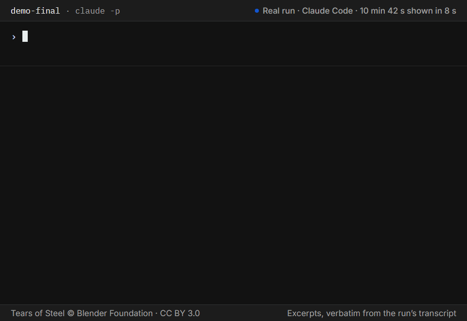
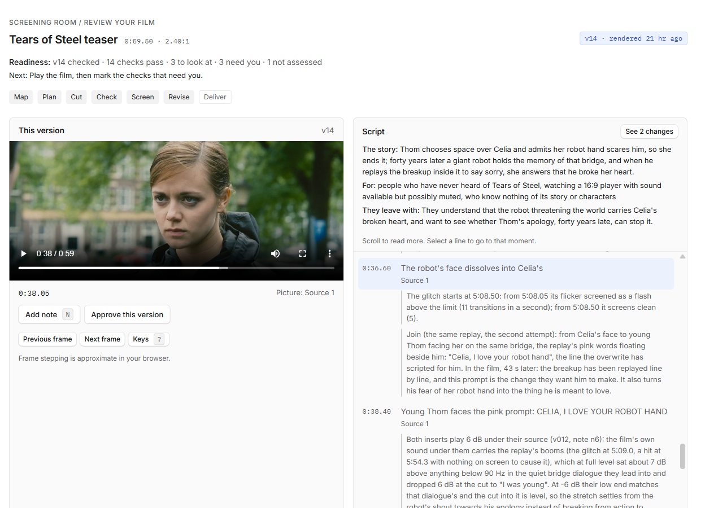
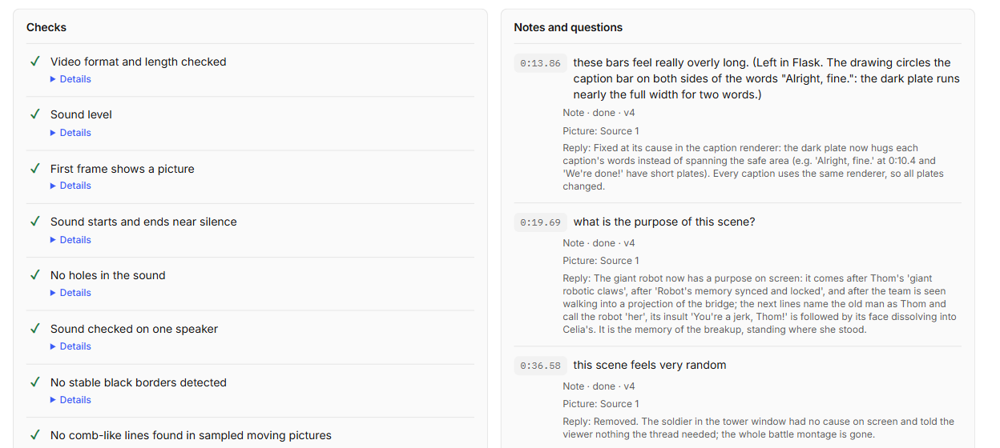
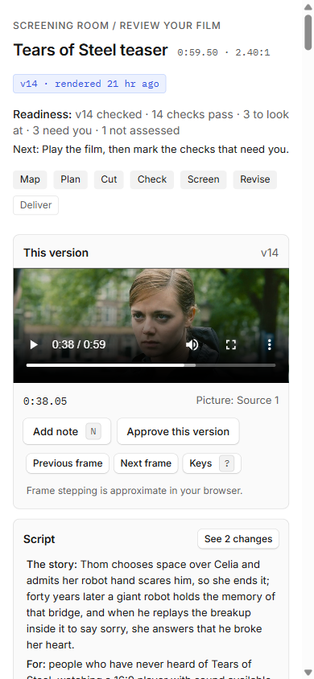
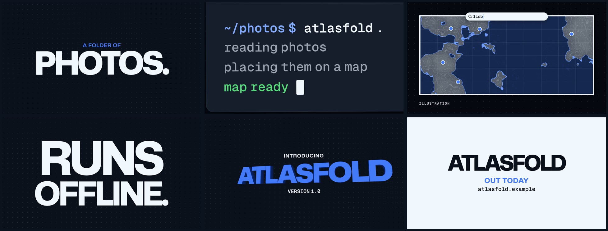

<h1 align="center"></h1>

<p align="center">
  <a href="https://github.com/JamesDimachkie/legible-film/actions/workflows/ci.yml"></a>
  <a href="https://github.com/JamesDimachkie/legible-film/releases/latest"></a>
  <a href="LICENSE"></a>
</p>

<h3 align="center">Your coding agent makes the video. Picture and sound keep one clock.</h3>

Legible Film is an Agent Skill that makes Claude Code, Codex and other coding agents into a video assistant you can
follow, for any kind of video. The agent draws launch films and motion graphics in an engine, cuts interviews,
podcasts and tutorials from their transcripts, puts animation inside footage on the words it belongs to, designs
sound for a finished picture, follows an editor's Premiere revisions, and makes quick conversions and checks. Every
film states who it is for and what they should know first; picture and sound share one cue list; every render is a
version that never changes; and every check says what it looked at and what it could not.

<p align="center">
  
</p>

*One request in Claude Code, and the run that followed, 10 min 42 s shown in 8 s: the agent set up a project, mapped
the clip, wrote and checked a paper edit, rendered it, had it reviewed by an agent that did not make it, rendered a
fourth version and checked the file. The lines are excerpts, verbatim from the run. Footage: Tears of Steel
(© Blender Foundation, [CC BY 3.0](https://creativecommons.org/licenses/by/3.0/)).*

In a terminal with Node.js, from your project folder:

```
npx skills add JamesDimachkie/legible-film
```

Then ask your agent once, `/legible-film setup` (or `doctor`) in Claude Code or `$legible-film setup` in Codex, to
check this machine; then the job, such as `/legible-film cut a 60-second story from interview.mp4` with a clip of your
own, or describe it in your own words. Cursor, Gemini CLI, GitHub Copilot, OpenCode, Amp, Goose and other
agents that read Agent Skills load it too. [Install](#install) has the Claude Code plugin and the other ways in.

Created by James Dimachkie.

## Try it

The example lives in the repository, not in the installed skill: `git clone
https://github.com/JamesDimachkie/legible-film`, then `cd legible-film`.

<!-- first-value:start -->
From a clone of this repository, a check and a first cut of the bundled example, a 23-second scene from
[Tears of Steel](examples/first-cut/README.md). It takes a few minutes, most of them installing FFmpeg. CI runs these
lines as written on fresh Linux, macOS and Windows machines and times them; a run fails if any check fails.

First, FFmpeg 5.1 or later and Python 3.9 or later. Open the steps for your system:

<details>
<summary>Linux (tested on Ubuntu 24.04 and Debian 12)</summary>

On Linux (Ubuntu 22.04 and Debian 11 ship an FFmpeg older than 5.1, which `setup.py` reports with what to do):

```bash
sudo apt-get update && sudo apt-get install -y ffmpeg python3 python3-venv
```

</details>
<details>
<summary>macOS (Homebrew)</summary>

On macOS, with [Homebrew](https://brew.sh):

```bash
brew install ffmpeg python
```

</details>
<details>
<summary>Windows (PowerShell)</summary>

On Windows, in PowerShell, with Python 3.9 or later installed. If `python --version` says Python was not found, install
it from [python.org](https://www.python.org/downloads/) and tick "Add python.exe to PATH" (or type `py` in place of
`python` in the first two lines of the Windows steps below). Install FFmpeg, then open a new PowerShell window so it
finds `ffmpeg`:

```powershell
winget install --id Gyan.FFmpeg -e --accept-source-agreements --accept-package-agreements
```

</details>

Then the skill, on Linux and macOS:

```bash
# Setup: numpy and Pillow, then the Python to use from here on, and what this machine can do
python3 skills/legible-film/scripts/setup.py --install core --yes
PY="$(python3 skills/legible-film/scripts/setup.py --json | python3 -c 'import json, sys; print(json.load(sys.stdin)["python"])')"
"$PY" skills/legible-film/scripts/setup.py
# Smoke test: one real case for each core path
"$PY" skills/legible-film/scripts/selftest.py --smoke
# First check: any video file, in plain states
"$PY" skills/legible-film/scripts/check.py --file examples/first-cut/tears-of-steel-bridge.mp4
# First cut: a project started from the example's paper edit, the clip and its transcript, a render and its checks
"$PY" skills/legible-film/scripts/project.py init ~/legible-film-first-cut --title "The real reason" --film examples/first-cut/film.md
"$PY" skills/legible-film/scripts/map.py add ~/legible-film-first-cut examples/first-cut/tears-of-steel-bridge.mp4 --role other
"$PY" skills/legible-film/scripts/map.py run ~/legible-film-first-cut --alias src_01 --words import:examples/first-cut/tears-of-steel-bridge.words.json
"$PY" skills/legible-film/scripts/cut.py render ~/legible-film-first-cut
"$PY" skills/legible-film/scripts/check.py ~/legible-film-first-cut
```

<details>
<summary>The same on Windows, in PowerShell</summary>

On Windows, in PowerShell:

```powershell
# Setup: numpy and Pillow, then the Python to use from here on, and what this machine can do
python skills/legible-film/scripts/setup.py --install core --yes
$py = (python skills/legible-film/scripts/setup.py --json | Out-String | ConvertFrom-Json).python
& $py skills/legible-film/scripts/setup.py
# Smoke test: one real case for each core path
& $py skills/legible-film/scripts/selftest.py --smoke
# First check: any video file, in plain states
& $py skills/legible-film/scripts/check.py --file examples/first-cut/tears-of-steel-bridge.mp4
# First cut: a project started from the example's paper edit, the clip and its transcript, a render and its checks
& $py skills/legible-film/scripts/project.py init $HOME/legible-film-first-cut --title "The real reason" --film examples/first-cut/film.md
& $py skills/legible-film/scripts/map.py add $HOME/legible-film-first-cut examples/first-cut/tears-of-steel-bridge.mp4 --role other
& $py skills/legible-film/scripts/map.py run $HOME/legible-film-first-cut --alias src_01 --words import:examples/first-cut/tears-of-steel-bridge.words.json
& $py skills/legible-film/scripts/cut.py render $HOME/legible-film-first-cut
& $py skills/legible-film/scripts/check.py $HOME/legible-film-first-cut
```

</details>

The first check ends `14 checks pass · 2 need you · 3 not assessed; 4 unconfirmed`: the file measures clean, a person
still has to watch and listen, each item it could not assess (captions, the cold read, sync) says what to give it, and
the four context fields (what the film is, for whom, why, and what the viewer knows by when) stay unconfirmed until
someone states them, which never fails a check. The cut is `legible-film-first-cut/cuts/v001/preview.mp4` in your
home folder. The render exits 1, which in every script means it ran and left something to look at (here a join with
no audible pause, at 0:14, and a background level drop at 0:04.75); 2 means it could not run. The last check exits 0.
To watch it in the Screening Room, run
`"$PY" skills/legible-film/scripts/screen.py serve ~/legible-film-first-cut --open` (in PowerShell, `& $py
skills/legible-film/scripts/screen.py serve $HOME/legible-film-first-cut --open`).
[The example's README](examples/first-cut/README.md) explains what the checks found.
<!-- first-value:end -->

## Why

An agent can assemble a video and inspect frames and measurements, but it cannot watch the cut at normal speed or
hear it. You can watch and listen, and leave notes at the moments that need work, but you cannot easily see what the
agent did. Mistakes slip through between the two: a cut lands in the middle of a word, a caption stays up after the
line is gone, the music buries the voice, a revision quietly changes a scene you had approved, and nobody can say
which version is which. Legible Film keeps the edit, the versions and the checks readable for both of you.

- **For the agent, evidence it can read.** Each source is mapped by what it contains: a word-timed transcript made
  locally for speech, shots with contact sheets for picture, loudness and silences for sound. A cut is drawn as a
  strip of frames, levels and words. A cut inside a spoken line goes in a quiet stretch measured in the audio rather
  than at the transcript's word edges; a join without one is flagged as a tight cut for a person to listen to, since
  quiet is not proof of a pause.
- **For you, a film you can read.** The edit is a script, `film.md`: who it is for, what it should leave them with
  and its story in one sentence, then the lines in the order they play, with what is on screen beside them. Strike a
  word to cut it. Every render is a new version; a diff lists the lines, words, durations and captions that changed, and
  the agent compares the rendered picture and sound with the version you approved.
- **One clock for picture and sound.** The cue list is exported from whatever owns the timeline (a page, the paper
  edit, a finished picture), with the picture's exact identity, so a retime makes the old list, bed and mix stale
  and every tool refuses them. Each cue has a scale (a turn, a follow span, a contact, a silence), and the delivered
  file is measured two ways, whether the frame changes at each cue and whether the sound follows the list.
- **Checks on the file a viewer receives,** in plain states: pass, look, fail, needs you, not assessed. Nothing is
  called watched or heard until a person has watched or heard it.

## How it works

The agent reads the request, picks one of six paths by who owns the timeline, and loads only what that path needs:

| Path | For | The timeline |
|---|---|---|
| create | launch films, motion graphics, social posts, loops, kinetic type, explainers drawn in code | a page (the film kit, HyperFrames, or Tesseract when you choose it) |
| cut | interviews, podcasts, tutorials, tightening, shorts, trailers from finished films, montages | the paper edit, `film.md` |
| insert | animation, titles and tracked graphics inside footage, timed to its words | the host edit |
| sound | effects, a score or a rescore for a picture that stays as it is | the picture |
| editor | an editor's Premiere or Resolve revisions, stale captions, a hand-off as XML | their timeline |
| quick | one file: a trim, reframe, conversion, captions, a check, a question about its sound | the file |

Every path but quick starts by stating the frame (what it is, for whom, why, and what the viewer knows by which
second), asking only for what is missing, and every path ends the same way: Check, Screen, Revise, Deliver.

When a film's look is open (a designed film, titles, music, a grade), it starts from your taste. The agent asks in
one message for references (films, ads, channels, a frame, your product) and what to take from each, each question
with a default you can accept. With none to hand, it offers three directions with examples and a style frame of each,
or asks who it is for, the feeling and what you never want. The answers become the project's `look.md`, which every
later stage, and the reviewer, reads.

A paper edit reads like a script. For example:

```markdown
## Hook
> int_01 12:03.40-12:07.10 We tried everything. ~~Honestly,~~ nothing held up in the field.
- broll_04 0:12.00-0:14.10 Crew unloading the van
## Why
> int_01 14:20.00-14:24.60 So we built the tool we needed, in six weeks.
  ~ screen_02 0:41.00-0:47.00 x1.5 Dashboard loads, push in to the map
```

`>` is a spoken line, `-` a picture, `~` a cutaway over the line above. The agent writes it; you can change it in
any text editor. After each stage the agent posts one line you can read at a glance:

```
v3 checked · 11 checks pass · 1 to look at · 2 need you
```

`v3` is the third version, in `cuts/v003/`.

Start with a command and what it applies to, or describe the job in your own words:

```
/legible-film cut a 60-second story from interview.mp4 and the b-roll in broll/
/legible-film look: three launch films I like are in refs/, match their pace, not their colour
/legible-film motion a 20-second product loop for our homepage, sound off by default
/legible-film score the approved picture: sparse, warm, a hit when the logo locks
/legible-film shorts three 30-second clips from podcast.mp4 for Reels, captions burned in
/legible-film convert demo.mov to a web MP4 that starts playing at once
/legible-film handoff v003 to Premiere so the editor can finish it
```

B-roll is supplementary footage placed over the interview. Burned-in captions are written into the picture and cannot
be switched off; they are for feeds that play muted.

Every 2.0 command still works, and each opens one path
([commands](skills/legible-film/references/commands.md) has the full map):

| Command | Path | For |
|---|---|---|
| `kit` (also `teaser`) | create | A type-led film, a beat-cut teaser, a sting or a loop |
| `look` (also `moodboard`) | create | Your references, or your expectations when you have none, for this film |
| `taste` (also `preferences`) | create | The preferences you have confirmed, read while planning and checked where measurable |
| `studio` | create | The best film a budget allows |
| `launch`, `design`, `motion` | create | New in 2.1: a launch film, a designed film or motion graphics |
| `map` | cut | Make the sources readable: transcripts, shots, sound |
| `plan` (also `brief`, `film`) | cut | The brief when one is needed, and the paper edit |
| `cut` | cut | Render the paper edit into a version |
| `shorts` (also `cutdown`) | cut | Short clips from a long video, or a new length or shape |
| `tighten` | cut | Shorten the dead air in a recording, as a paper edit you can read and undo |
| `screen` (also `review`) | the project's own | Open the Screening Room |
| `revise` | the project's own | Turn notes into a new version, and show what else changed |
| `deliver` | the project's own | Final files, captions, mastering and a delivery report |
| `insert` | insert | An animation in place of a passage's picture, timed to its words |
| `graphics` (also `cavalry`) | insert | A lower third, logo or title over the footage, made in Cavalry (driven by the agent) or another engine |
| `spatial` (also `track`, `blur`) | insert | Pin a graphic to a moving surface, put a title behind a person, blur a moving face |
| `score`, `mix` | sound | Sound to picture; a voice over music |
| `sound`, `sfx` | sound | New in 2.1: sound or effects for a picture |
| `premiere` | editor | Follow an editor's Premiere timeline and captions through revisions |
| `handoff` (also `export`) | editor | A version as a timeline Premiere or Resolve opens, with its captions |
| `quick` | quick | A simple change to one file: trim, reframe, convert, compress, GIF |
| `convert` | quick | New in 2.1: convert one file |
| `check` | quick, or the project's own | Check a version or any file |
| `captions` | quick, or the project's own | Captions for a video |
| `grade` | quick | A scorecard for a version or any video |
| `setup` (also `doctor`) | before any path | What this machine can do and how to fix the rest; installs local transcription or the film kit's browser with your yes |

More requests are in [examples/prompts.md](examples/prompts.md).

## The Screening Room

<picture>
  <source media="(prefers-color-scheme: dark)" srcset=".github/media/screening-room-dark.png">
  
</picture>

*The Screening Room on a one-minute teaser cut with the skill from
[Tears of Steel](https://mango.blender.org/) (© Blender Foundation, [CC BY 3.0](https://creativecommons.org/licenses/by/3.0/)).
Agents with the skill made the first cut, re-planned it around one line of thought after the viewer's notes, and
answered the later notes. Two small fixes (a dissolve and a replaced held frame) were made by hand. The script states
its story, its audience and what they should leave with, and every join carries a note saying what links it.*

One local page holds the cut, its script, the checks, your notes and every version. Play it, and the script follows
along; click a line to jump to it. Press `N` to leave a note pinned to the moment and the words being spoken. Replay a
moment or step through it frame by frame, or shuttle with J, K and L as in an editor (`?` lists the keys). Tick off what
only you can judge (watched muted, heard with sound), and approve. In live mode your notes land in the project folder as
you write them, and the page follows new versions as the agent renders them. It runs on your machine only, behind a
private link made for that session; nothing is uploaded.

<p>
  
  
</p>

### Reviewing together: Flask

When you review away from your machine, or with a client, an editor or a team, [Flask](https://flask.do) is the
collaboration and feedback layer this project recommends. The agent posts each version to one Flask asset through
Flask's MCP server; reviewers watch it at speed and leave notes pinned to moments, with drawings on the frame and
replies. The agent brings every note back into the project, fixes it at its cause, answers it with what changed and
posts the next version. The project folder stays the record, and the Screening Room stays the private, local option:
nothing is uploaded without your yes. The teaser above was revised this way, through five versions of notes in Flask.

## The scorecard

A cut broken down the way an editor would: content (hook, structure, pacing, emotion, ending), picture (cover, cut
rhythm, text and captions, lighting and image, framing), sound (voice, music and effects, mix) and delivery (platform
fit, accessibility), each scored 0 to 10 with the moments that justify it.

- `grade.py` gathers image, motion and audio diagnostics (exposure, blur and compression damage, cuts and motion,
  black bars, frozen stretches, loudness, clipping, stereo that cancels on a phone speaker) and builds a reviewer
  packet: the rubric, a dense sample of the opening, a loudness picture, scopes for sampled candidate shots, cover
  candidates and the transcript. It does not turn the measurements into scores.
- A reviewer who did not make the cut scores from the packet, citing times and packet evidence. The merge checks that
  each citation exists, not that its interpretation is right.
- Your own score for any dimension (a rating of the whole cut) takes precedence over the agent's, and both stay
  visible.
- It is a guide to what to change first, not a pass mark. Each dimension says how far it has been validated.
- `grade.py paper` scores the script before anything renders, `grade.py hooks` lists the lines that could open the
  film, and `grade.py thumbs` proposes covers.

## Working with an editor in Premiere

When a person edits in Premiere, their timeline stays the source of truth and the agent assists. `check.py --file` with
the export's captions, its Final Cut Pro XML and the source transcripts checks the export as delivered, and
`exchange.py` follows every caption into the next revision (unchanged, moved, stale, split or removed), naming what it
cannot map rather than guessing. [The editor path](skills/legible-film/paths/editor.md) has the steps. The other way
round, `exchange.py write` hands a version to an editor as a Final Cut Pro 7 XML sequence of the original clips with
their handles, plus its captions and a list of what the XML cannot carry
([Hand-off from a paper edit](skills/legible-film/paths/editor.md#hand-off-from-a-paper-edit)).

## What's inside

<details>
<summary>Every script, by stage</summary>

| Stage | Scripts |
|---|---|
| The loop | `setup.py`, `project.py`, `map.py`, `look.py`, `transcribe.py`, `cut.py`, `tighten.py`, `strip.py`, `check.py`, `screen.py`, `grade.py`, `exchange.py`, `taste.py` |
| Footage | `assemble.py`, `reframe.py`, `transcript_cut.py`, `captions.py`, `track.py`, `matte.py`, `spatial.py` |
| Sound | `tempo_map.py`, `conform.py`, `spot_cues.py`, `make_sound_kit.py`, `sound_library.py`, `mix_cues.py`, `sound_check.py`, `listen.py`, `voice_clean.py` |
| Film kit | `new_film.py`, `film_check.py`, `make_film.py`, `film_render.py`, `motion_blur.py` |
| Checks | `qc_file.py`, `frame_sheet.py`, `flash_scan.py`, `blank_scan.py`, `motion_scan.py`, `region_check.py`, `cue_list.py`, `cue_onsets.py`, `sync_check.py`, `compare_versions.py`, `delivery_check.py`, `onion_frames.py` |
| The environment | `selftest.py`, `kit_selftest.py`, `with_lock.py` |

What each one answers is in [references/scripts.md](skills/legible-film/references/scripts.md); every script
explains itself with `--help`.

</details>

**The film kit** makes type-led films: a small browser engine, one command that takes a film from preflight to
checked delivery files, and a synthesised sound kit.

[](.github/media/atlasfold-showcase.mp4?raw=true)

*Atlasfold, a launch film for a fictional product, made with the film kit at 16:9 and 9:16.
[Watch it with sound](.github/media/atlasfold-showcase.mp4?raw=true)
(24 s).*

**Graphics from other engines** go over the footage with one `~ over` line when they have transparency: a lower
third, logo or title made in Cavalry, After Effects or another engine that renders it. A full-frame piece, from
HyperFrames, Remotion or the film kit, goes in as a cutaway, and the paper edit stays the film's one clock. With Cavalry 2.8 the agent builds the scene itself through
Cavalry's own MCP server and looks at any frame of it, and you keep the scene to adjust by hand
([engines](skills/legible-film/references/engines.md#cavalry-driven-through-its-mcp-server-checked-2026-10-31)).

## What is tested, and what is still experimental

| Part | State | What it rests on |
|---|---|---|
| Cutting recordings from a paper edit: cuts in measured pauses, immutable versions, diffs | Tested | 240 of 240 cuts in measured silence on test material; known-answer self-tests |
| Checks on the delivered file (spec, loudness, true peak, flashing, holes, captions, contrast) | Tested on known answers | the self-test on Linux, macOS and Windows; every check says what it cannot see |
| Following an editor's Premiere revisions and checking their export | Read-only; tested on one editor's real revisions | every clip and placed word matched |
| Handing a cut to an editor as Final Cut Pro 7 XML (Premiere, Resolve) | Experimental | read back by OpenTimelineIO on synthetic projects, every cut within half a frame; opened in Premiere in one editor's synthetic test, whose pixel-aspect and stereo findings are fixed but not yet re-checked there; Resolve untested |
| Spatial layers: tracking, pins, titles behind a person, tracked blur | Experimental | under 1 px on synthetic planes; on public footage a sign tracked every frame and a face did not; a blur stops the render rather than miss a frame |
| Mattes (key, luma, difference, a subject model) | Experimental | the keys on known answers; the subject model misses people and fringes hair on hard frames |
| Tightening a recording | Experimental | synthetic speech with decaying word tails; on a public reading, 6 of 22 long pauses shortened, every cut near room tone; on one editor's raw interview, 10 cuts (7.3% shorter), all 184 words kept, no clipped word found by listening models, two joins with a visible arm jump; a music bed must be declared |
| Preferences the person confirms | Experimental | known-answer cases and a dry run on one person's notes; nothing shows they predict notes |
| Captions against a transcript | Tested on synthetic cases and one editor's real captions | a transcript can mishear; a person reads every caption |
| Local transcription | Works; accuracy on your audio not measured | transcripts are drafts until a person reads them |
| The Screening Room | Used by one person on one film | no measurement yet |
| Reviewing together in Flask | Used by one person on one teaser, through five versions | every note came back into the project and was closed with a reply in the next version |
| The scorecard | Experimental | a blind test on real and damaged cuts: 4 dimensions told them apart on both, 7 on one, 4 not yet; printed beside every score |
| Agents choosing the story (compared spines, an independent review of each cut) | Experimental | calibrated judges; review raised blind scores on two films; not yet shown on harder material |
| The film kit | Tested | its own self-test in CI |
| The six paths, the frame and the command map (2.1) | Experimental | the command-map test in the docs check, in CI; the routing eval harness is in [evals](evals/README.md), with no 2.1 results published |
| Cue lists bound to their picture, registered masters, conform and attach-mix (2.1) | Experimental | each tool's acceptance checks in the self-test; a tool is named in the skill's steps only after its check passes |
| Listening by instrument, `listen.py` (2.1) | Experimental | known-answer cases and local replays, every number with its n and spread; its sync screen's null is uncalibrated, so follow coupling is a screening signal, never significance; its labels are hints, and the sound is unheard until a person listens |
| Graphics over footage (`~ over`), and Cavalry driven through its MCP server | Experimental | known-answer self-tests: PNG and PNG MOV overlays frame for frame through a cut, ProRes 4444 and VP9 decoded with their colours and transparency; one Cavalry title and one lower third built, seen, rendered, cut and checked on Windows, and Cavalry driven from a fresh Claude Code session; macOS untested |

## Evidence

What has been measured, and on what:

- **Cuts land in pauses.** On the paper edit's test material, all 240 cuts inside spoken lines fell in silence
  measured in the audio. Cutting at the transcript's word edges instead put 52 cuts in speech and 78 in breaths, and
  clipped 6 words.
- **Every frame shown.** Final renders from MP4, WebM and MKV sources at 29.97, 24 and 25 fps showed every expected
  source frame: 88 of 88 frame identities across 18 renders.
- **Flashing.** `flash_scan.py` gives the known answer on 86 synthetic cases: general and saturated-red flashes
  around the three-per-second limit, small and large areas, and alternating patterns.
- **Premiere.** On one professional editor's two revisions, every clip (78 of 78, 81 of 81) and every placed word
  (479 of 479, 462 of 462, within 1 ms) matched. The same editor's agent opened a hand-off (`exchange.py write`) of a
  synthetic 300-frame project in Premiere Pro 26.3 on macOS: every source came online, the five clips and the
  dissolve landed where expected, both J and L overlaps measured right, and 6 of 6 markers and 10 of 10 captions
  matched. It also found the sequence imported with the wrong pixel aspect and stereo played as centred mono; the
  hand-off now declares square pixels and pans each stereo channel, not yet re-checked in Premiere.
- **The scorecard.** Validation per dimension, above.
- **The scripts.** In CI on the 2.0.0 release candidate, 1,666 self-test cases pass on Windows (which also runs the
  speech-synthesis cases), 1,659 on Linux (with OpenCV, so the tracking cases run), 1,656 on Python 3.9 with FFmpeg
  5.1 (the oldest supported) and 1,633 on macOS, with none failing. The 65 that need faster-whisper, a browser or the
  network are recorded as not run, and on macOS one HDR case its FFmpeg cannot run. On a Windows laptop with
  faster-whisper and a browser, every case passed except the one that needs the network.
- **First value.** On fresh CI machines the quickstart above, run as written, went from setup to a checked first cut
  in 71 s on macOS, 92 s on Debian 12, 128 s on Ubuntu 24.04 and 151 s on Windows on the final run, the first check
  18 to 39 s in, not counting installing FFmpeg. Over the last three runs the totals ranged from 67 to 71 s on macOS,
  90 to 129 s on Debian, 88 to 130 s on Ubuntu and 127 to 151 s on Windows.
- **Review.** Each part was reviewed by a model of the other family from the one that wrote it (GPT-6.1 Terra and
  Claude), and the launch changes by three reviewers from both families. Each fix started from a case that failed.

Not yet measured: how often local transcription mishears (transcripts stay drafts until a person reads them), and
film-level evaluations per kind of video ([evals/README.md](evals/README.md) says what has been run).

## Install

**Any agent that reads Agent Skills** (Claude Code, Codex, Cursor, Gemini CLI, GitHub Copilot, OpenCode, Amp, Goose).
In a terminal with Node.js installed, from your project folder:

```
npx skills add JamesDimachkie/legible-film
```

Add `-g` for a user-wide install or `-a codex` (or another agent name) to target one agent.

**Claude Code plugin.** In a Claude Code session:

```
/plugin marketplace add JamesDimachkie/legible-film
/plugin install legible-film@jamesdimachkie
```

Claude Code names a plugin's skills by plugin and skill, so through the plugin the command is
`/legible-film:legible-film` (for example `/legible-film:legible-film setup`).

**By hand:** copy `skills/legible-film/` into `~/.claude/skills/` for Claude Code, or into `.agents/skills/` (project)
or `~/.agents/skills/` (user) for most other agents.

**Requirements:** Python 3.9 or later and FFmpeg and ffprobe 5.1 or later on `PATH`. `setup.py --install core` installs
`numpy` and `Pillow`, into that Python when it allows it, otherwise into a private environment in your user data folder
(it never changes a system Python), and names the Python to run the scripts with. `/legible-film setup` checks
everything else and gives each missing piece a fix command for your shell. Local transcription uses faster-whisper
(`--install transcription`, with your yes); a model is downloaded only when you allow it, after its size is named.
Tracking and mattes use OpenCV and onnxruntime (`--install spatial`; the 26 MB subject model with `--download`), and
automatic crops follow faces with OpenCV (`--install faces`). The film kit also needs Node.js 18 or later; with it,
`--install kit` adds Playwright and Chromium (about 160 MB), with your yes.

**Check the installation.** From a clone of this repository (in an installed copy, run `scripts/selftest.py` from
the skill's folder), with the Python `setup.py` names (`$PY`, as in [Try it](#try-it); in PowerShell, `& $py`):

```
"$PY" skills/legible-film/scripts/selftest.py --smoke
"$PY" skills/legible-film/scripts/selftest.py --force --json selftest-report.json
```

`--smoke` decodes, checks, imports a transcript, renders a cut and checks its captions on synthetic media, in
about ten seconds. The full run builds synthetic media with known answers and runs every script's cases, about 2,150
of them: 16 to 32 minutes on CI's Linux and Windows machines. It records any case it could not run, with the
reason (some need faster-whisper, a browser or Windows speech synthesis). Without
`--force`, a run may reuse an earlier pass on the same environment; `--quick` checks the dependencies in a second. A
pass shows the scripts measure these synthetic answers on your machine; it says nothing about the quality of a
particular film.

## What stays manual

These are not built, or stay outside the skill, in 2.1:

- Writing an original score; earshot's own sound-making, sound finding and realness scores (an optional,
  separate tool).
- Warping reading holds into an existing timeline, and refining word onsets against the audio.
- Frame-exact 3D.
- Cue export from engines other than the film kit, HyperFrames (its timelines with the `lf-cues` block) and pages that
  declare `window.__cues`.
- Builds in Tesseract, which run in its own skills; this skill hands off the brief, the frame and a plan cue list,
  and takes the master back.
- Every act of watching and listening.

## Limits

- The scripts measure; they do not watch or listen. Whether a cut works is decided by people, and every report says
  what was checked and what was not.
- Transcripts are drafts until a person has read them against the audio, names and numbers first.
- The scorecard's judgments come from an agent reading stills, scopes and words; it does not experience motion or
  sound, and each dimension says how far it has been validated.
- `flash_scan.py` screens for WCAG 2.3.1 flashing; it is not a broadcast PSE certification.
- A cut handed to Premiere or Resolve (`exchange.py write`) carries the clips, joins, sound and markers, not crops,
  speed changes, fade curves or the mix (it lists each). It has been opened in Premiere in one synthetic test, not
  in Resolve; a variable-frame-rate source did not transfer identically there, and transitions do not round-trip
  exactly (Premiere's own re-export replaced custom audio fades).
- Rendering passes every frame through Python: a plain 1080p30 cut with sound rendered at about 15 frames a second on
  a 16-core laptop (one measured run), about half real time, so a 30-minute film takes about an hour; 4K runs at
  about 4 frames a second. Previews render from smaller proxies.
- A graphic goes over footage when it has transparency: a PNG, or a video at the film's size and frame rate (`~ over`,
  from Cavalry, After Effects or another engine). Pins and titles behind a person take still images only, and the film
  kit's renders are opaque, so a kit animation enters as a full-frame cutaway.
- The self-test runs on Windows, Linux and macOS with Python 3.12, and on Linux with Python 3.9 and FFmpeg 5.1,
  the oldest supported; Python 3.13 passes its quick and smoke checks on Windows. Other versions are untested. The
  2.1 tools are verified on Linux and Windows; on macOS they have run only in the CI self-test.

## Related tools

- [Auto-Editor](https://github.com/WyattBlue/auto-editor) cuts by silence or motion thresholds from the command line
  and exports timelines to editing applications.
- [Editly](https://github.com/mifi/editly) renders a video from a declarative JSON timeline.
- [cook](https://github.com/Leonxlnx/cook) runs long visual builds in code against reference images and videos; the
  look step here (references first, motion studied frame by frame, stills beside their references) draws on it.
- [HyperFrames](https://github.com/heygen-com/hyperframes) renders HTML to video from a paused timeline; the create
  path exports a HyperFrames page's cue list from its timeline labels and keeps the sound on that clock.
- [Strobe](https://github.com/hridaya423/strobe) renders HyperFrames and Remotion projects on the GPU, several times
  faster on macOS and Windows; it is new and not tested here, and
  [engines](skills/legible-film/references/engines.md#faster-renders-of-hyperframes-and-remotion-projects-checked-2026-10-31)
  says how to check its output against the engine's own.

Legible Film is for an agent and a person working on one readable edit, with checks on the delivered file.

## Contributing

Suggestions and fixes are welcome; see [CONTRIBUTING.md](CONTRIBUTING.md). Rules change only with evidence (a defect,
a measurement, a source), and every script change keeps `selftest.py` passing.

## Licence

Apache-2.0. Copyright 2026 James Dimachkie. See [LICENSE](LICENSE) and [NOTICE](NOTICE).
