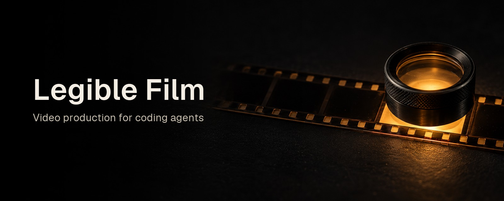

<h1 align="center"></h1>

[](https://github.com/JamesDimachkie/legible-film/actions/workflows/ci.yml)

Legible Film is an Agent Skill for video production: a folder of instructions, references and scripts that a coding
agent (Claude Code, Codex, Cursor, Gemini CLI, GitHub Copilot and others) loads when a task calls for it. Its name
is the standard it holds every film to: legible to the viewer it is made for, and honest about what was checked.

It teaches the agent to make short videos the way a careful director, editor and finisher would: one story, picture
and sound composed on one clock, every claim traced to a source, and the delivered file checked before anyone ships
it.

In a small blind-graded test (five requests, one run each on one model), agents with the skill met 35 of 35
expectations and agents without it met 10 of 35. Every prompt, output and grade is
[published](evals/results/2026-10-27/README.md), with what the test could not control.

Created by James Dimachkie. Licensed under Apache-2.0.

## Why it exists

Coding agents can now build a launch film, a product demo or an explainer from code, generated assets and FFmpeg.
They can also render something that passes every build check and still fails the viewer: text that leaves before it
can be read, a brand colour shifted by the encoder, a soundtrack that clips on the platform's re-encode, a picture
that claims more than the product does, or an approved scene broken by a fix somewhere else. Nor can an agent watch
its own film at speed or hear it.

This skill encodes a working method for those problems. It was built from making launch films, product demos and
client videos with coding agents in 2026. Its rules come from defects found in real cuts, notes from the people who
watched and listened, measurements on delivered files, and published standards and research checked against their
sources. Its scripts were written for that work and are tested against synthetic media with known answers.

## What it does

The agent works through nine steps, each ending on a condition it can check:

1. **Brief, facts and format.** Who it is for, where it plays, what must read muted, and a facts file for every claim.
2. **Story and score.** The change the film makes in its viewer, three concepts, one governing operation, and a score
   that plans every moment across picture, motion, text, music, effects and the product's truth.
3. **The clock.** One timing source for picture and sound, sync points computed from the animation, and a reading
   window for every essential text.
4. **Picture.** A world with reasons, motion with weight and cause, joins chosen for what they mean, and craft rules
   drawn from rendered defects.
5. **Sound.** What leads each passage, which events sound, how it ends, and one hard rule: nothing jarring.
6. **Render, finish and mux.** Frozen sources, correct colour conversion and tags, audio matched to picture.
7. **QC the delivered file.** Spec, decode, colour, loudness, true peak after a platform re-encode, flashing, blank
   frames, motion, sync and claims, run on the exact file a viewer will receive.
8. **Review with people.** Muted at viewing size, then with sound, then pauses; synthetic critics verified before
   anything changes; approved work kept approved.
9. **Deliver.** The file, its hash, and a report that says what was checked, what was not, and who has watched and
   listened.

Until a named person has watched the delivered file, the agent reports it as unwatched; until someone has listened to
a file with sound, as unheard. It asks before spending money, uploading private material to a hosted service, or
publishing anything.

## See it check a file

`evals/make_fixtures.py` builds a four-second clip with three planted defects. Asked to check it before posting, an
agent following the skill runs the bundled scripts on that exact file:

```
python skills/legible-film/scripts/qc_file.py evals/files/check-me.mp4 --spec 640x360@30 --duration 4 \
    --vcodec h264 --pix-fmt yuv420p --color bt709 --audio required
python skills/legible-film/scripts/flash_scan.py evals/files/check-me.mp4
```

Their output, shortened to the findings:

```
check-me.mp4: h264 640x360 yuv420p @ 30 fps, 3.2 s; colour None/None/None; faststart False
  loudness: -21.8 LUFS integrated, LRA 20.0 LU, true peak -20.8 dBTP
  warning: colour primaries untagged: players will guess; tag them (e.g. bt709)
  warning: sound at level in the first 5 ms: a click unless a hit is designed for frame 0
  warning: the last 10 ms is not near silence: check for a cut-off tail unless the ending is a designed hard stop
  FAIL duration: expected 4.0 +/- 0.0333 s, got 3.2
  FAIL color_tags: expected ['bt709', 'bt709', 'bt709'], got [None, None, None]
  not checked: picture content, motion at playback speed, text legibility at viewing size, flashing (flash_scan.py), how the sound sounds, sync to picture events, claims, rights
check-me.mp4: 96 frames at 30 fps; busiest second: general 11 transitions (at 1.1 s), red 11 (at 1.1 s); FLAGGED
```

All three defects are caught: muxing with `-shortest` cut the picture to 3.2 s, the colour tags are missing, and a
5 Hz full-frame flash fails the WCAG 2.3.1 screen. The report also names what no script checked, which goes into the
delivery report alongside who has watched and listened.

## Install

**Claude Code.** In a Claude Code session:

```
/plugin marketplace add JamesDimachkie/legible-film
/plugin install legible-film@jamesdimachkie
```

**Any agent that reads Agent Skills** (Codex, Cursor, Gemini CLI, GitHub Copilot, OpenCode, Amp, Goose, Claude Code).
In a terminal with Node.js installed, from your project folder:

```
npx skills add JamesDimachkie/legible-film
```

Add `-g` for a user-wide install or `-a codex` (or another agent name) to target one agent.

**By hand:** copy `skills/legible-film/` into `~/.claude/skills/` for Claude Code, or into `.agents/skills/`
(project) or `~/.agents/skills/` (user) for most other agents.

**Requirements:** Python 3.9 or later, FFmpeg and ffprobe on `PATH`, and `pip install numpy Pillow` (into whichever
Python environment the agent will use) for the scripts. If you are unsure whether these are installed, ask your coding
agent: "Install Legible Film, check its requirements and run its self-test; ask me before changing anything that
needs my permission."

**Check the installation.** From a clone of this repository:

```
git clone https://github.com/JamesDimachkie/legible-film
cd legible-film
python skills/legible-film/scripts/selftest.py
```

If you installed through a plugin or `npx skills`, the same script sits in the installed skill's `scripts/` folder;
ask your agent to run the Legible Film skill's self-test. It builds synthetic media with known answers and runs 38
checks across every script in about half a minute, writing only to a temporary folder.

## Use it

Ask for what you want. Agents that support skills load this one from its description when a request is video work;
to be certain, name it: "Use Legible Film to check this cut." For example:

- "Make a 30-second launch film for our release, 16:9 for the post and 9:16 for stories. Facts are in `docs/`."
- "Here is the cut. Check it before I post it."
- "The client says the end feels rushed. Fix that without touching anything they already approved."
- "Which tools should I use to turn these screen recordings into a two-minute tutorial with captions?"

More are in [examples/prompts.md](examples/prompts.md).

## Studio grade

For the best film the budget allows, ask for it by name: "Use Legible Film at studio grade for our launch film.
Budget up to $800 for music, voice and stock." The agent then works the way a small studio would:

- **It studies first.** It finds comparable pieces whose makers explained their decisions, annotates what to borrow
  from each and what must not transfer, and mines your product's own material for the idea.
- **It shows instead of asking.** You choose between things you can watch and hear: three short, rough idea videos
  with temporary sound, sample stills of the look made from the hardest frames in every shape you will post, and a
  rough timed version of the whole film before anything is polished. Everything temporary is labelled.
- **It spends on what the film needs most.** Purchases and generation runs are line items you approve, each showing
  what is payable now, what is already committed and what remains under your cap, with each licence checked for the
  real use ([finding assets](skills/legible-film/references/assets.md),
  [making them](skills/legible-film/references/generation.md)).
- **It runs specialist passes** on story, picture, type, editing, sound design, music, voice, mix and finishing.
- **It leaves the watching and listening to people.** It prepares and measures; you, or viewers you name, judge how
  the film moves and sounds, and nothing is reported as watched or heard until someone has.
- **It keeps raising the weakest moment** until viewers can answer six questions with evidence (understanding,
  specificity, experience, earned payoff, truth and afterimage) or you decide to stop.

Every gate still applies: nothing is bought, uploaded or published without you. The full method is in
[studio](skills/legible-film/references/studio.md).

## What is inside

```
skills/legible-film/
  SKILL.md            the method: principles, gates, nine steps, revisions, hard limits, gotchas
  references/         story-and-score, timing, picture, product-demos, sound, claims-and-rights, formats,
                      engines, finishing, ffmpeg-cookbook, qc, review, case-library, sources;
                      studio grade, finding assets, making assets with generative tools
  scripts/            QC tools for the delivered file, plus a self-test
  assets/templates/   brief, treatment, facts, score, cues, asset register, budget, review log, critic brief,
                      delivery report
  assets/examples/    a filled 40-second score for a fictional product
evals/                behaviour and trigger evaluations for the skill itself
```

| Script | Answers |
|---|---|
| `qc_file.py` | Does the file meet its spec and decode cleanly? Colour tags, loudness, true peak before and after a lossy re-encode, head and tail levels, mono fold-down, brand colour patches. |
| `frame_sheet.py` | What exactly is on screen at these times, at full size or at viewing size? |
| `flash_scan.py` | Is there a candidate WCAG 2.3.1 flash sequence? |
| `blank_scan.py` | Are there near-empty frames outside the designed ones? |
| `motion_scan.py` | Cuts, one-frame intrusions, repeated frames in motion, holds, first motion, loop seam. |
| `cue_onsets.py` | Does each sound start on its cue, do silent cues stay quiet, and is the hit rate better than chance? |
| `sync_check.py` | Is the delivered audio offset or drifting against the approved mix? |
| `compare_versions.py` | Where did the picture change between two renders? |
| `onion_frames.py` | What path and spacing does a move have across these frames? |

## Limits

- The scripts measure; they do not watch or listen. Rhythm, feel, comprehension and how the sound sounds are decided
  by people, and the skill says so in every report.
- `flash_scan.py` screens for WCAG 2.3.1 flashing. It is not a Harding, IRIS or broadcast PSE certification.
- Tool versions, platform specs and provider terms in the references were checked on 2026-10-27 and change often;
  each is dated, and linked to its source wherever a stable page exists, so it can be re-checked.
- Evaluations are small: five requests, one run each with and without the skill on one model, graded blind by
  another model family against expectations written by the skill's author. They measure whether an agent follows
  the method, not how good its film is, and whether agents load the skill unprompted has not been tested. Details
  are in [evals/README.md](evals/README.md).

## Contributing

Suggestions and fixes are welcome; see [CONTRIBUTING.md](CONTRIBUTING.md). Rules change only with evidence (a
defect, a measurement, a source), and every script change keeps `selftest.py` passing.

## Licence

Apache-2.0. Copyright 2026 James Dimachkie. See [LICENSE](LICENSE) and [NOTICE](NOTICE).
